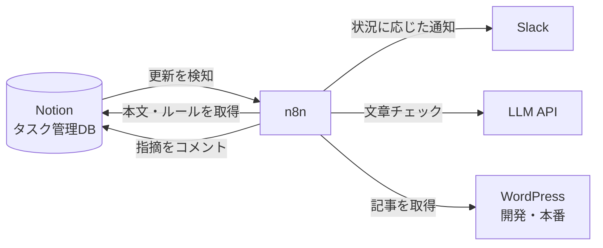

# PRタスク自動化（Notion × n8n × Slack）

研究室の広報活動（記事・HP・SNSの3係）で使っている、進捗通知と文章チェックの仕組みです。
タスク管理はNotion、通知はSlackで行い、その間をn8n（研究室サーバーのDocker上で稼働）でつないでいます。

> このリポジトリのワークフローは、研究室固有の情報（NotionのID、SlackのユーザーID、サーバーのアドレス、APIキーなど）を仮の値に置き換えたものです。そのままでは動きません。

## 解決したかった課題

- 進捗はOneDrive上のExcelでリーダーが管理し、作業者 → タスクリーダー（TL）→ 先生（PO）と確認が回るたびに、Slackで個別に連絡していた。リーダーの負担が大きく、メンバーも全体の進捗をつかみにくかった。
- 先生から「誤字脱字や形式の不備は、内容の確認以前の問題」と指摘されることが多く、確認する側の負担になっていた。

## 構成



| ワークフロー | 内容 |
| --- | --- |
| `notify-content` / `notify-sns` / `notify-hp-dev` / `notify-hp-prod` | 係ごとに、Notionのステータスが変わったら担当者・TL・先生にSlackで通知する |
| `daily-remind` | 毎朝9時に、期限が近いタスクの状況をまとめて通知する |
| `two-week-notice` | 投稿予定日の2週間前に、作業開始を知らせる |
| `ai-check` | Notionのチェックボックスを入れると、文章を自動でチェックし、結果をNotionにコメントする |

## 1. 進捗通知（notify-*）

1. Notionのデータベースの更新を検知する（複数の箇所が同時に更新されても、1ページずつ処理する）。
2. 投稿予定日が2週間以内の記事だけを対象にする。
3. 前回保存したステータスと比べて、**変わったときだけ**次に進む。
4. ステータスで分岐し、相手を変えて通知する。
   - 修正依頼 → 担当グループのメンバー
   - TL確認 → タスクリーダー
   - PO確認 → 先生
   - 済 → 担当グループ（HPの投稿が済んでいれば、先生にSNS投稿できることも伝える）
5. 今回のステータスをNotionに保存し、次回の比較に使う。

## 2. 文章チェック（ai-check）

Notionで「AIチェック」のチェックボックスを入れた行だけを処理します。係ごとに4つの分岐があります。

**SNS・記事（コンテンツ）**
1. ページ本文から、係の見出し（例：「SNS」）の下にあるブロックを探して、テキストにする。
2. チェックリスト（Notionの1ページ）を読み込み、本文と一緒にLLMに渡す。
3. LLMの返答（JSON）を読み取り、指摘を一覧にしてNotionにコメントする。
4. チェックボックスを外す。

**HP（WordPressの開発環境・本番環境）**
LLMは使わず、ルールで判定します。
1. WordPressのREST APIで記事を取得し、HTMLからテキストを取り出す。
2. アイキャッチ画像とカテゴリが設定されているかを確認する。
3. Notionの原稿（日本語部分）とHPの本文を**文単位**で比べ、片方にしかない文を指摘する。改行位置の違いは無視する。

## 工夫した点

- **進捗管理をNotionに移す**：OneDrive上のExcelからNotionに移し、進捗と原稿を1か所にまとめた。各作業者が自分でステータスを更新し、それをきっかけに通知が届く。
- **連絡手段は変えない**：通知は、普段から使っているSlackに送る。
- **既存のワークフローを壊さない**：文章チェックは通知とは別のワークフローにした。
- **段階的に導入する**：文章チェックは、チェックボックスを入れたときだけ動く手動実行から始めた。精度を確かめてから、自動実行に切り替えられる。
- **ルールをコードから分ける**：チェックリストはNotionの1ページにまとめ、実行のたびに読み込む。誰でもNotionを編集するだけでルールを更新できる。
- **通知を増やしすぎない**：ステータスが変わったときだけ通知し、文章チェックの結果はSlackではなくNotionのコメントで返す。
- **LLMを使う部分と使わない部分を分ける**：HPの設定漏れや原稿との差分のように、機械的に判定できるものはコードで確実にチェックする。

## 結果と課題

- 文章チェックでは、表記ゆれ、全角と半角の混在、固有名詞のスペルミスなど、人が見落としやすい細かい不備を拾えている。
- 一方で、実行回数はまだ10回程度で、メンバーへの浸透が課題。
- LLMの指摘には誤りもあるため、コメントには「最終判断は担当者が行う」と明記している。

## ファイル

```
workflows/   n8nから書き出したワークフロー（情報を置き換え済み）
code/        各ワークフローのCodeノードのJavaScript（読みやすいように抜き出したもの）
```

使う場合は、n8nでワークフローをインポートし、Notion・Slack・WordPressの認証情報と、`NOTION_TASK_DB_ID` などの仮の値を自分の環境に合わせて設定してください。

## AIの利用について

設計の相談とコードの書き方の補助に、生成AIを使いました。構成の判断、実装、動作確認は自分で行っています。
